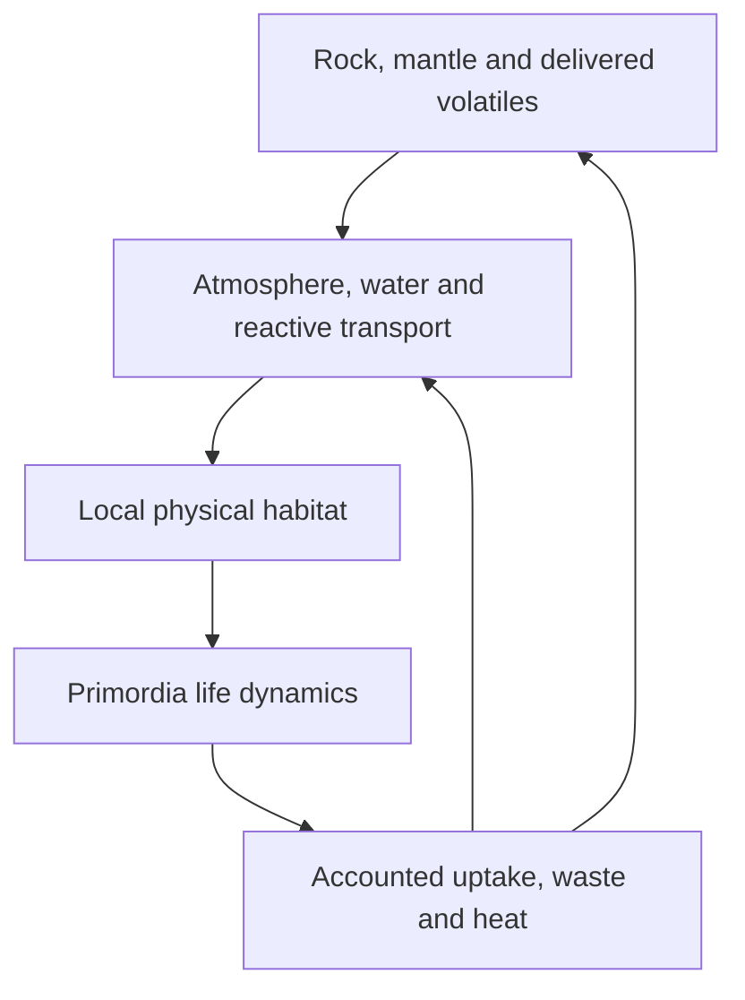

# Physical habitats for Truth × Primordia

Date: 2026-10-24. Status: research, executed existing-model probes, and proposed implementation sequence. No new planetary solver, native adapter, material producer or biological feedback is implemented. Fork work is explicitly deferred by the user.

## Goal and recovered context

Truth supplies physical conditions to the life simulation, and biological processes alter the same physical voxel world. The October 23 [Primordia Truth Integration plan v0.2](https://drive.google.com/file/d/1AgS5aF4lhe6A5JM1UGp-oWdxjXatTCDg/view) supplies the context: preserve Rust/wgpu, keep Truth's ECS authoritative, investigate regime classifiers and multiresolution transitions, and distinguish observed replication from biological individuality. The author-aligned questions remain replication under costs, differentiated bonded collectives, homochirality, environmental geometry, and open-endedness. A computational abiogenesis research path is available; terrestrial chemical abiogenesis is not thereby established.

The user's present priority is planetary geology, atmospheric fluid motion, impacts and chemistry. Water must have a material origin and a pressure/temperature-dependent phase history. Clouds redistribute water and energy; they do not create a water inventory. CO2 must be outgassed, delivered, dissolved, reacted, trapped or removed through accounted processes.

## Existing work to connect, not duplicate

| Work | Pinned evidence | Boundary |
| --- | --- | --- |
| Current production baseline | `58b0fd91ea65b7a4b3a1f571f22f3d394374a871` | Used for this run; later PR code was not silently composed |
| [PR44 water research](https://github.com/octave-commons/Truth/pull/44) | `8f9ee36b8848e046e40eb5fb36ab4cbab5ab6946` | Common-basis H/O reservations and capacity accounting; no actual water producer |
| [PR47 water allocation](https://github.com/octave-commons/Truth/pull/47) | `239eb9b2494241e3a9850b67b77d37407bd2191b` | Proposed exact 17-element stocks, finite phase draws; physical origin and kinetics unresolved |
| [PR38 life account](https://github.com/octave-commons/Truth/pull/38) | `1bda27a27f1e88c061ebdff718264a55ef2a9938` | Implemented pure carbon accounting on its branch; no habitat discovery/ECS coupling |
| [PR50 resource action](https://github.com/octave-commons/Truth/pull/50) | `7f05e4f47c5af55937e2d3149a8d293ae0870e36` | Proposed bounded uptake/yield, explicit modeled intervals; no physical producer |
| [Foresight PR146](https://github.com/open-hax/foresight/pull/146) | Native lifecycle plan | Async batches, intervention ordering and immutable results; adapter unimplemented |

PR47's existing water owner is `a4744132-2328-4cb2-a550-e1328d346673`. Its supplied ice/vapor allocation is not a liquid-water thermodynamics model. New work must extend its reviewed boundary deliberately, not replace it or treat supplied reaction extent as measured chemistry. PR38 remains a carbon account, not a general geochemistry inventory.

## What ran now

Seven probes execute existing Truth functions; the impact probe uses the actual frozen-world emitters and production write-set fold with an injected existing collision packet. They are controlled fixtures, not natural planet-formation histories. The dry variant deliberately changes composition while holding the original thermal/retention labels, exposing what the downstream seed does and does not check.

| Probe | Observed outcome | What it establishes |
| --- | --- | --- |
| Temperate rocky seed | 288 K; 3 layers, 7 plates, 6 convection cells; zero layer-mass residual | Deterministic initialized geometry, not evolving tectonics |
| Volatile-poor temperate seed | Still `:env/temperate-habitable`; water mass untracked | The seed's environment label does not prove liquid-water supply |
| Frozen icy seed | 102 K; 3 layers, 3 plates, 4 convection cells | Existing cold-field initialization |
| H-free oxygen-bearing silicate at 1 atmosphere | Ecology adopted, moisture 1.0 | Existing H/O moisture proxy cannot be used as a water inventory |
| Same silicate at 1 Pa | Ecology adopted, moisture 1.0 | This ecology admission path does not establish pressure-supported liquid water |
| Neither H nor O | No ecology adopted | Negative control distinguishes the proxy mechanism |
| 68 m Fe impact, 30 km/s | Final classifier diameter 3098.69 m; 1680 excavated in-band voxel entries, 20 melt and 12 vapor tags after folding | Existing approximate collision-to-voxel queue works; no transferred vapor atmosphere or hydrothermal circulation |

The impact transient diameter is 2478.95 m, predicted melt volume 5.143e6 m³ and vapor volume 3.175e6 m³. Classifier volumes describe the whole fitted crater; tagged counts describe only the resolved band and are not volume-conservation proof. Queue jobs drain by fold 3 in this run. The packet is injected at the existing boundary; no incoming asteroid orbit, atmospheric entry or shock-fluid solution is claimed.

Focused verification passed **60 tests / 327 assertions**, covering interior, voxel carving, chemistry systems and ecology. [Raw scenarios](evidence/2026-10-24/scenarios.edn), [tests](evidence/2026-10-24/focused-tests.txt), [runtime provenance](evidence/2026-10-24/runtime.json). Normal CLI dependency resolution failed in the JVM; the selected run used exact project Clojure and tagged Malli/dynaload sources on an explicit classpath. No stub validators or substituted solver were used. Full strict analysis remains unavailable because clj-kondo and clojure-lsp are absent. No native display was run.

## Current physical gaps

`domain.interior/seed-field` initializes plates and convection cells; these are not resolved mantle dynamics. `domain.atmosphere` emits XUV escape, while the formation classifier estimates retention capability, not pressure, clouds, rainfall or fluid circulation. `domain.chemistry/molecular-composition` is a diagnostic; its pressure argument is unused and it does not settle competitive molecular inventories. `domain.ecology.system` sums elemental H/O into a moisture proxy. `law.composition/element-set` has 17 elements but no phosphorus; extending it for CHNOPS chemistry requires migration/schema review, not adding an unvalidated key.

Existing cratering is a scaling-law model with fit limits, voxel tags and cooling; it is not a shock hydrocode, and missing vapor/ejecta destinations cannot be treated as accounted atmosphere. Existing cosmological tick lengths also cannot be reused blindly for convection, chemistry or microbial dynamics.

## Research that changes the model

These are peer-reviewed papers or official reference specifications. The findings below are bounded to the retrieved abstract/method excerpts; no numerical figure replication is claimed. Recommendations are our proposed use of the sources, not results reported by their authors.

0. **Hydrogen can arrive in the building blocks, not only late comets.** [Piani et al. (2020), *Science*](https://doi.org/10.1126/science.aba1948) measured hydrogen and isotopic compositions in enstatite chondrites, supporting an indigenous contribution to Earth's volatile supply. The 2025 *Icarus* study [The source of hydrogen in Earth's building blocks](https://doi.org/10.1016/j.icarus.2025.116588) uses sulfur X-ray spectroscopy to investigate H-bearing phases. Counterevidence matters: [Origin of Earth's hydrogen and carbon constrained by their core-mantle partitioning and bulk Earth abundance (2025)](https://doi.org/10.1038/s41467-025-65729-5) combines partitioning experiments with accretion models and requires carbonaceous contributions under its assumptions. Use different delivery/retention histories as competing scenarios; neither H in a meteorite nor bulk planetary H proves surface liquid water. Track the chain: accreted H/O-bearing material → interior storage/reactions → outgassing → phase changes and transport, with impact delivery/loss as additional terms. Do not hardcode one source fraction.

1. **Volatile partitioning before the ocean.** Solomatova & Caracas (2021), *Science Advances*, [doi:10.1126/sciadv.abj0406](https://doi.org/10.1126/sciadv.abj0406), use atomistic calculations to examine volatile behavior at a magma-ocean boundary. In their modeled conditions carbon leaves the melt more readily than hydrogen. Treat interior retention and outgassing history separately; an initial steam-only atmosphere is one scenario, not a universal starting state. Test the sensitivity of surface water to interior retention and redox assumptions. The calculation is not a planetary accretion history or measured outgassing rate.

2. **Ocean formation depends on cloud dynamics and history.** Turbet et al. (2021), *Nature*, [doi:10.1038/s41586-021-03873-w](https://doi.org/10.1038/s41586-021-03873-w), [author manuscript](https://arxiv.org/abs/2110.08801), model hot early Earth/Venus in 3D. Nightside clouds warm their modeled steam atmospheres and can prevent condensation. A world cooling from steam can differ from an initially wet world under comparable forcing. Use matched wet-start/hot-start experiments; do not use orbital equilibrium temperature alone to declare oceans. Their Venus conclusion is model-dependent, not an instruction to hardcode a planet class.

3. **Crustal composition does not uniquely identify tectonic regime.** Turner et al. (2025), *Nature*, [doi:10.1038/s41586-025-08719-3](https://doi.org/10.1038/s41586-025-08719-3), show a magma-ocean protocrust can acquire continental-like incompatible trace-element patterns without requiring the usual subduction explanation. Compare stagnant-lid and mobile-lid endmembers; do not seed modern tectonics from a single compositional signature. The July 2025 table corrections are part of the current article. This is a geochemical model, not a direct Hadean crust map.

4. **Climate needs rock–water–carbon feedback.** Krissansen-Totton, Arney & Catling (2018), *PNAS*, [doi:10.1073/pnas.1721296115](https://doi.org/10.1073/pnas.1721296115), couple carbon cycling, seafloor/continental weathering and ocean chemistry. Their model supports temperate Archean climates over explored assumptions. Track CO2 transfer to dissolved carbon and minerals, not a permanent atmospheric greenhouse setting. Compare weathering-enabled and disabled cases. Their modeled Archean constraints are not guaranteed Hadean initial conditions or a fixed target temperature.

5. **Impacts can change redox as well as terrain.** Zahnle, Lupu, Catling & Wogan (2020), *Planetary Science Journal*, [doi:10.3847/PSJ/ab7e2c](https://doi.org/10.3847/PSJ/ab7e2c), [author PDF](https://faculty.washington.edu/dcatling/Zahnle2020_Impact-induced-Miller-Urey-atmospheres.pdf), model transient reducing atmospheres produced by impacts and subsequent evolution. Impact metal, available water, mixing and kinetics matter. Account for heat, atmospheric loss, delivered material and reactive iron separately. Compare wet/dry targets and reducing/oxidized impactors. A crater is not automatically productive prebiotic chemistry.

6. **Impact heat can sustain long-lived aqueous environments.** Pickersgill and colleagues (2026), *Communications Earth & Environment*, [doi:10.1038/s43247-026-03618-5](https://doi.org/10.1038/s43247-026-03618-5), combine radioisotopic constraints and hydrothermal modeling at Chicxulub, supporting activity for at least about 8 Myr. [Parameters/data](https://doi.org/10.5525/gla.researchdata.2272) are available. This supports tracking permeability, residual heat and fluid access after impact. Chicxulub is a younger analogue with different target rocks; neither its duration nor its scale transfers directly to our 68 m impactor.

7. **Hydrothermal chemistry has strong countermodels.** Tutolo, Seyfried & Tosca (2020), *PNAS*, [doi:10.1073/pnas.1921042117](https://doi.org/10.1073/pnas.1921042117), show silica-rich Precambrian fluids can suppress H2 yields relative to modern silica-poor analogues. Tutolo (2026), *PNAS*, [doi:10.1073/pnas.2613108123](https://doi.org/10.1073/pnas.2613108123), critically reexamines alkaline-vent origin scenarios, including in-situ pH, sulfur availability and kinetic limitations. Keep temperature-correct pH, mineralogy and reaction kinetics explicit; test vent, impact-lake and wet–dry alternatives. This challenges specific vent hypotheses; it does not disprove all hydrothermal origins or establish another origin scenario.

A broader current synthesis is Vulpius, Runge & Noack (2026), *Nature Reviews Earth & Environment*, [doi:10.1038/s43017-026-00803-0](https://doi.org/10.1038/s43017-026-00803-0). Its retrieved abstract distinguishes accretion, magma-ocean outgassing, later outgassing and uncertain redox history. Full text was inaccessible; use it as an orientation review, not an extracted parameter source.

## Numerical reference work

- [IAPWS-95](https://iapws.org/documents/release/IAPWS-95.download) / [IF97](https://iapws.org/technical-guidance/release/IF97-Rev): verify water thermodynamics over the chosen validity range. Ice needs its own supported formulation. Pressure, salinity and enthalpy matter; a 273–373 K check is not a general water-phase law. Water-rich supercritical states require explicit handling.
- [USGS PHREEQC v3](https://water.usgs.gov/water-resources/software/PHREEQC/documentation/phreeqc3-html/phreeqc3-2.htm): proposed offline oracle for carbonate speciation, mineral reactions and reactive transport. Pin the database and validate its T/P/salinity/species coverage; official documentation warns about database consistency. No PHREEQC execution or integration occurred here.
- [Held & Suarez (1994)](https://ntrs.nasa.gov/citations/19950050186): a dry atmospheric dynamical-core benchmark, not cloud validation. Start atmospheric transport with conservation, hydrostatic rest, passive-tracer advection and convergence; add moist phase-change/latent-heat tests separately. No global circulation model was run here.
- [ASPECT](https://aspect.geodynamics.org/): an independent geodynamic benchmark/reference, not a selected replacement for Truth. Regional heat/porous flow and a parameterized interior can precede a global mantle solver if their approximation envelopes are explicit.

## Three scenario families to implement next

| Scenario | Matched controls | Required outputs | Falsifier / unsupported condition |
| --- | --- | --- | --- |
| Cooling basaltic world: interior volatiles → air → condensate → pond/ocean | Same forcing/inventory with hot-start vs wet-start; dry twin; cloud physics varied | Element stocks by reservoir, T/P, water phase masses, radiative/latent energy, rainfall/runoff and CO2 partition | Rain appears with zero water; equilibrium-temperature label stands in for solved surface climate |
| Hydrothermal rock–water column beneath a pond or vent | Heat off; impermeable rock; silica-rich vs silica-poor fluids; no biology | Fluid/heat flux, reacted mineral amount, redox availability, pH at in-situ conditions, residence time | Prescribed infinite H2 source; no depletion, heat input or chemical validity range |
| Impact and ecological recovery | No-impact twin; wet/dry targets; reducing/oxidized impactor; inert/active biological flux | Excavation/melt/ejecta destinations, energy split, gas/water transfer, permeability changes, habitat loss/recovery | Crater tags counted as settled atmospheric vapor; fit used outside validity without an explicit unsupported result |

The first deliverable is a small causal habitat on the existing voxel/ECS path, not a full Earth-history claim. Begin with local transport plus a declared global boundary. Move toward planetary circulation only after dry/moist benchmarks. Global and local timesteps must advance the same accepted physical interval through stable substeps; no skipped microbial or chemical time.

## Proposed exchange contract before domain changes

A habitat observation identifies world/habitat/cell IDs, voxel revision, modeled interval in seconds, units/model versions, T (K), pressure (Pa), volume (m³), radiation and heat flux (W/m²), velocity (m/s), and finite mineral/gas/liquid stocks. Elemental kg are conserved accounts; molecular/mineral species are constrained allocations of those same elements, never extra mass added on top. Track latent/sensible energy with a declared reference. Unknown inventories, missing kinetics, unsupported temperatures or uncalibrated Primordia mappings return unsupported, not zero availability.

Biology returns proposals: per-cell elemental consumption/production, heat, gas changes and mineral/porosity effects, with cause/request UUID, source and target revisions, actual interval and model provenance. Do not infer real CO2 uptake or O2 production from an opcode counter. Specify a calibrated metabolism/translation profile first. Early biology must not be assumed oxygenic. An inert synthetic flux source can test accounting, but is not observed Primordia feedback.

One serial owner settles competing transfers with equal source debits/destination credits, bounded donor stocks, exactly-once retry handling and actual interval accounting. Each physical component retains one declared writer; life never mutates voxels during fan-out. Close local+global+escaped/deposited reservoirs in mass/element/charge and energy accounting. Rejected steps change no stock and consume no unmodeled time. Keep bulk chemical charge separate from transport of charged particles unless an explicit electrodynamic model exists.

Use three independent regime decisions: environment (phase/redox/transport validity), biological evidence (copying/heredity/collective behavior), and numerical fidelity (error-controlled coarse-graining). None is a universal `alive` switch. Coarse models run in shadow and must reproduce held-out perturbations before they replace detailed habitat dynamics.

## First implementation order and acceptance

1. Extend the existing PR47 owner through review: finite elemental donor origin, liquid/ice/vapor stores, oxygen competition and pressure/enthalpy phase changes. Red controls include zero H with abundant silicate O, dry atmosphere, unknown stock, phase overdraw, and repeated donor depletion. No source schema widening for P until explicitly reviewed.
2. Add local heat, conservative water flow and tracer transport on the existing voxel representation. Red tests cover hydrostatic rest, sealed boundaries, tracer pulses, grid/timestep convergence, condensation/evaporation latent heat and dry no-rain. Add finite outgassing and carbon speciation against reference fixtures; atmosphere clouds and circulation get their own validated slice.
3. Connect existing impact plans to conservative material/energy destinations and permeability/heat relaxation. Retain fit limits; do not pretend to resolve shock waves from crater geometry.
4. Bind a declared Primordia environmental profile and then settle supported biological fluxes into those same reservoirs. Reuse PR38/PR50 accounting where their scope matches; do not treat their completion as a chemistry implementation. Verify no-biology and replay controls before discussing environmental engineering by life.

The linked new epic/stories are incoming planning inputs, not canonical Rheos transitions. Review and red/green gates apply before new domain implementation. Historical records, existing donor plans and the computational-life evidence remain unchanged.

## Reproduction

With the project dependencies available: `clojure -Sdeps '{:paths ["src" "test"]}' -M docs/research/planetary-habitats/scenarios.clj` from the repository root. It accesses private test fixture helpers deliberately; it is a research characterization harness, not a production API. Run the four namespaces named in the raw test log with `clojure.test` for the focused gate. Exact alternative classpath provenance is in runtime.json. Re-run outputs to a new dated segment; do not overwrite historical evidence. No perpetual actor, timer, GPU run or deployed service is claimed.
